<p align="center">
  
</p>

# SolidLocker
**Version control for SolidWorks teams**

Keep every part, assembly, and drawing in your team's GitHub repo with its full history, without making everyone on the team learn Git.

SolidLocker gives common Git workflows simple names and buttons. You can **Save & Share** your work, branch off to try a new design, restore an older version, or ask a teammate to review your changes before they are added back to the main branch.

It also solves one of the biggest problems with using Git for CAD: **SolidWorks files cannot be merged.** SolidLocker uses Git LFS file locking so only one person can edit a file at a time. Lock an assembly or drawing and its referenced files are locked with it, preventing two people from accidentally working on the same files and overwriting each other's work.

SolidLocker works with the GitHub repo and accounts your team already uses. There is no separate server to run, no new account to create, and no PDM system to maintain.

Developed by [Scaven X](https://github.com/scavenx) at RU Airborne.

<p align="center">
  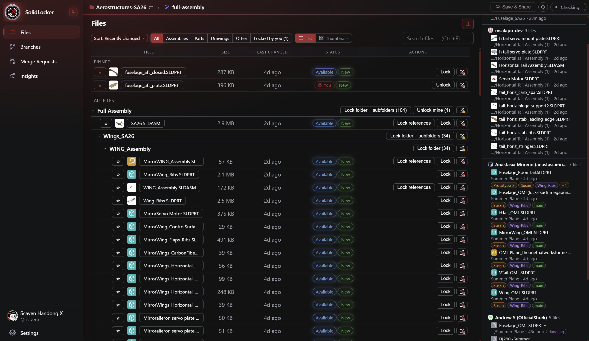
  <br>
  <em>Every file in the project, who is holding which, and what you can pick up.</em>
</p>

<p align="center">
  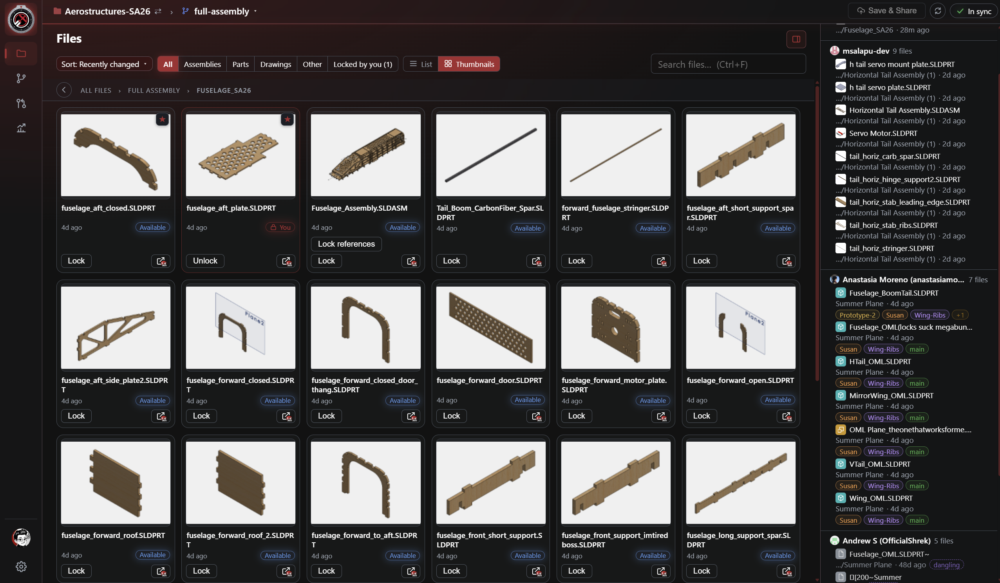
  <br>
  <em>The same project as thumbnails, using the preview SolidWorks saved of each document.</em>
</p>

## The problem it solves

Git is great for software because code can usually be compared and merged when
two people change the same file. SolidWorks files do not work that way. If two
people edit the same part separately, Git cannot merge their changes
afterward. One version has to replace the other.

SolidLocker fills that gap with file locking. Files stay read-only until you
lock them, and the lock is recorded on GitHub right away. If someone else
already has the file locked, you cannot accidentally start editing it too.

GitHub and GitHub Desktop do not help much here either. Their pull request and
merge screens are built around showing a text diff, and a SolidWorks file has
nothing to diff, so neither the website nor GitHub Desktop can resolve a
conflict in a SolidWorks file. They just tell you to sort it out with Git in a
terminal. SolidLocker gives that an intuitive interface instead: a railway map
of the branches, a side-by-side sort box that shows both versions of a
clashing file with a picture, author and date so you pick the one to keep, and
reviews inside the app where a teammate can accept your picks or choose
differently before the work joins the main branch. Branching off and restoring
an earlier version are buttons too.

## Getting started

### Requirements

- Windows 10 or 11.
- Git and Git LFS, signed in to GitHub (GitHub Desktop provides all of this).
- A GitHub repository that uses Git LFS with SolidWorks files marked
  `lockable`.
- SolidWorks, for the "lock with parts" detection.

### Install

1. Download the latest `SolidLocker_x64-setup.exe` from the [Releases](https://github.com/RU-Airborne/SolidLocker/releases) page
   and run it.
2. Open SolidLocker and point it at your team's project folder (a local clone of
   the GitHub repository).

### Notes on Windows SmartScreen

  <p align="center">
  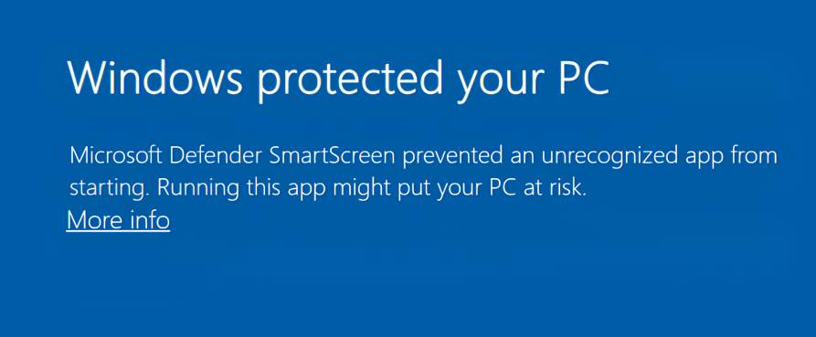
  <br>
  <em>Windows SmartScreen would block installation due to unrecognized publisher</em>
  </p>

When you run the installer, Windows may show a blue "Windows protected your PC" box. That is
SmartScreen, and it appears because the installer is not signed with a paid code signing
certificate, not because anything is wrong with it. Click **More info**, then **Run anyway**.

If you would rather not take our word for it, everything is here in the open: clone the
repository and read the source yourself (or have an AI read it for you), then build the
installer or run it in dev mode on your own machine. See [Building from source](#building-from-source).

## Feature Highlights

- **Git without the barrier of Git**: Nobody on the team needs to know Git. You
  "Save & Share" instead of commit and push, "Request to merge" instead of
  opening a pull request. Every term is listed against its Git meaning in
  [What the words mean](#what-the-words-mean).

- **Safe by default**: Files stay read-only until you lock them, so nothing gets
  changed by accident. Locks are taken on GitHub's server, so two people can
  never hold the same file.

- **Lock with parts**: Lock a drawing or an assembly and every part it uses is
  locked with it. The list of parts comes from your running copy of SolidWorks,
  so it matches what the file actually references. Whole folders lock in one
  click too.

  <p align="center">
  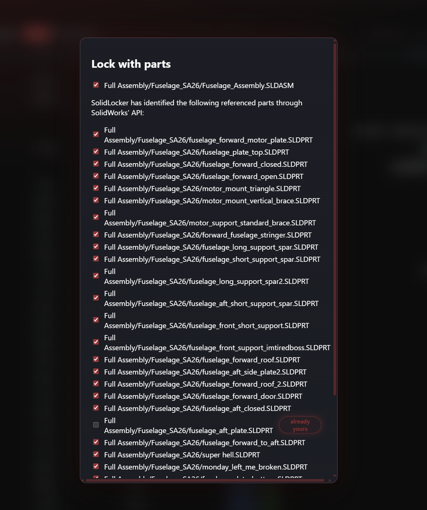
  <br>
  <em>Lock with parts: the references come straight from your running SolidWorks, and the whole set locks in one click.</em>
  </p>

- **Branches page**: a railway map of every branch, coloured so they are easy to
  tell apart. Open a commit to see what changed, look at a file as it was then, restore it, or branch off from that point.

  <p align="center">
  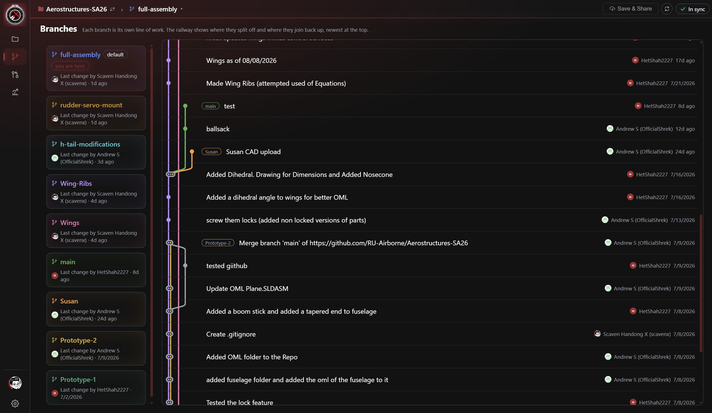
  <br>
  <em>The Branches page: every branch on one railway, with branch off, restore and merge a click away</em>
  </p>

- **Get an old version back, safely**: Restore puts an earlier version back as a
  new save, so nothing later is thrown away. Branch off starts a new branch from
  that point instead, leaving the branch you came from untouched. Either way the
  version you are on now is never lost.

  <table align="center">
    <tr>
      <td align="center">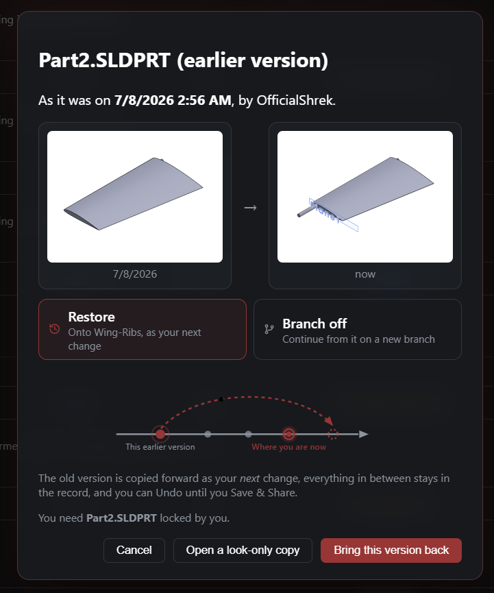<br><em>Restore: bring an earlier version back.</em></td>
      <td align="center"><br><em>Branch off: start a new branch from an earlier point.</em></td>
    </tr>
  </table>

- **Merge branches**: See what the other branch would bring before anything
  changes and whether both branches touched the same CAD file.
  Merge on your own machine, or send a request for a team lead to approve if branch protection rules are active. If files clash, the sort box opens first, with both versions side by side so you pick the one to keep.

  <p align="center">
  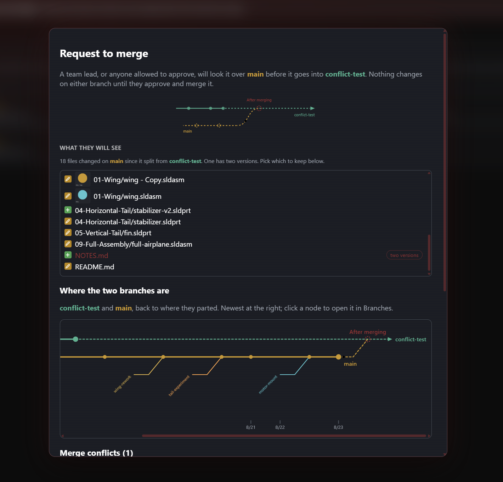
  <br>
  <em>Merge: see what the other branch brings before anything changes.</em>
  </p>

- **Approve merge requests right inside the app**: GitHub cannot show a diff of a SolidWorks
  file. SolidLocker handles the whole
  request itself. Send one from the Merge dialog with a title, a note and your
  suggested picks. The team lead sees the changed files with thumbnails, the
  conversation, and the same sort box, and can accept your picks, choose
  differently, ask for changes, or approve and merge in one go.

  <p align="center">
  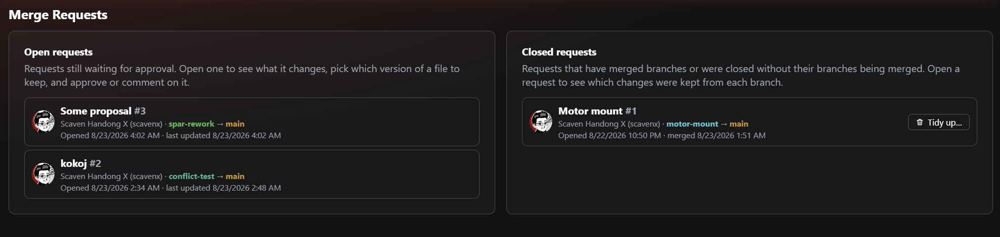
  <br>
  <em>Merge Requests: open and closed requests, shown directly in the app.</em>
  </p>

  <p align="center">
  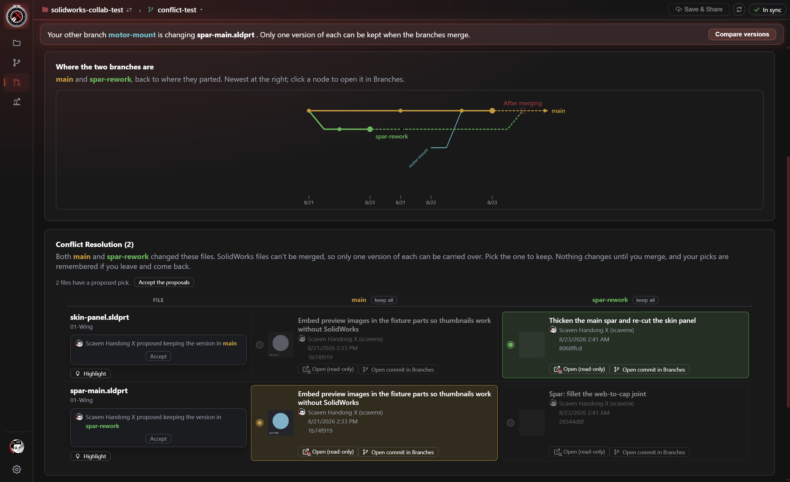
  <br>
  <em>The sort box: both versions of a clashing file, with a picture, author and date, so you choose the one to keep.</em>
  </p>

- **See who has what**: Every locked file and who holds it, with a button to jump
  straight to it. Locks living on another branch are flagged rather than left
  looking missing. Waiting on a file? "Notify when free" pings you the moment it
  is unlocked.

- **Insights**: What the team has been up to across every branch. What changed
  this week, shared changes per day, the parts being reworked most, and who has
  been busiest lately.
<div align="center">
  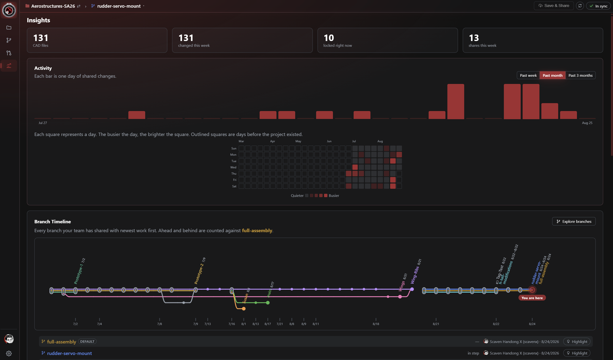
  <br>


  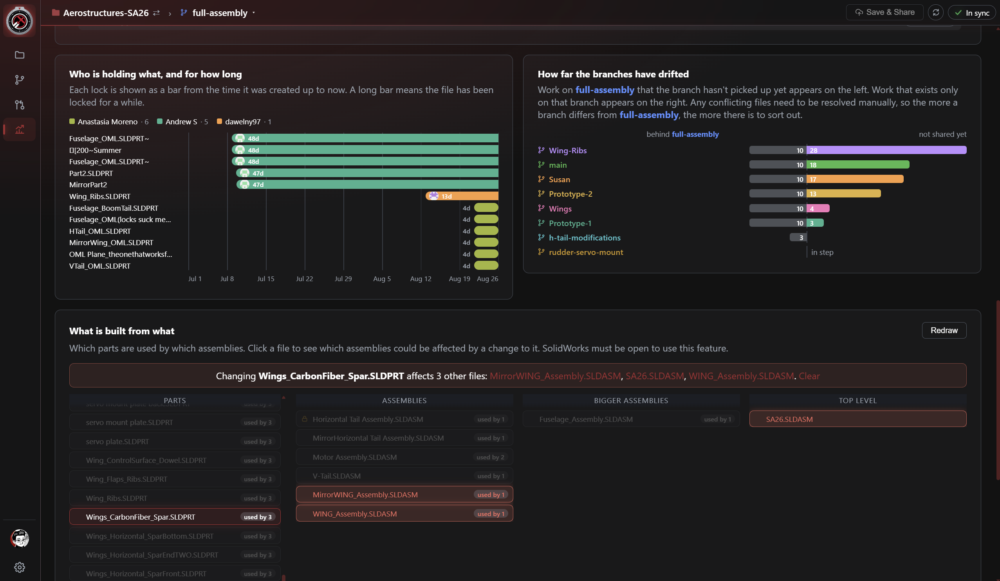

  <br>


  <em>The Insights page: what the team has worked on across every branch.</em>
</div>

- **Works offline**: Keep editing anything you locked before the connection went.
  Locking and sharing pause until you are back, then pick up on their own.

- **Runs in the background**: Closing the window keeps SolidLocker in the system
  tray, still guarding your files and still able to tell you when the file you
  are waiting on comes free.


### First run

SolidLocker needs Git and Git LFS on your computer, plus a GitHub sign in. The
easiest way to get all three at once is
[GitHub Desktop](https://desktop.github.com/): install it, sign in, and
SolidLocker will find everything it needs. If Git is missing, the app tells you
and links you to the download.

The first time SolidLocker talks to GitHub, your system credential helper opens
a browser sign in. That is your own GitHub login. SolidLocker never asks for a
password itself and stores no credentials of its own.

## Working with SolidLocker

1. **Lock** the file you want to work on. It turns writable on your machine, and
   everyone else can see it's yours. Nobody else can grab it until you let go.
   Lock an assembly or a drawing and all of its parts come along with it.
2. **Edit** it in SolidWorks like you normally would.
3. **Save & Share** when you hit a good stopping point. One click saves your work
   up to the team repo (a commit and a push) so everyone else can pull it.
4. **Unlock** when you're done. SolidLocker makes sure your latest version is
   safely on GitHub first, then frees the file for the next person.


## What the words mean

SolidLocker uses everyday words in the app. If you know Git, this is what they map to.

| In SolidLocker | In Git / Git LFS |
| --- | --- |
| Lock / Unlock | `git lfs lock` / `git lfs unlock` on the file. Files stay read-only until locked. |
| Lock with parts | One `git lfs lock` per referenced part, found by asking SolidWorks for the file's references. |
| Force unlock | `git lfs unlock --force` |
| Save & Share | `git add`, `git commit`, `git push` (LFS objects upload with the push). |
| Sync now / "pulling in team changes" | `git fetch` then a fast-forward `git pull`, every 60 seconds or on demand. |
| Who has what | `git lfs locks`, matched against branches and files. |
| Discard | `git restore` on the file (unlocked files are never touched). |
| Set aside | Untracked files are moved to a `<project>-SetAside` folder next to the project before a switch. Not a `git stash`. |
| Switch branch | `git switch`, after checking nothing locked would be trampled. |
| Branch off from here | `git switch -c <name> <commit>` |
| View this version (read-only) | A temporary detached checkout of that commit; one click returns you. |
| Restore this version | `git restore --source <commit> -- <file>`, then Save & Share when you are happy. |
| Branches page | `git log --all --graph`, drawn as a railway. |
| Insights page | `git log` with per-file and per-author statistics across all branches. |
| Merge into … directly | `git merge` of the other branch into the one you are on, then push. |
| "Merge conflicts" / the sort box | A merge conflict on a binary file, resolved by keeping `--ours` or `--theirs` for each file. |
| Undo (after a merge) | `git reset --hard ORIG_HEAD`, only while nothing has been shared yet. |
| Merge request / Request to merge | A pull request on GitHub. |
| Picks / proposals | Per-file review comments on the pull request, marked so the app can read them back. |
| Ask for changes | A "changes requested" review on the pull request. |
| Approve and merge | An approving review followed by merging the pull request. |
| Close without merging | Closing the pull request; the branch is left as it is. |
| Tidy up / Delete branch | `git push origin --delete <branch>` and `git branch -D <branch>`, only once the branch is fully merged. |
| Fix permissions | Re-applies `lfs.setlockablereadonly`: locked files writable, everything else read-only. |

## Good to know

- **Locks aren't tied to a branch**: A file you lock is locked everywhere.
  SolidLocker sorts out which branch it lives on for you.
- **Auto sync only pulls when your folder is clean**: If you've got edits going,
  it leaves them alone and waits.
- **Unlock is a safety net**: If your latest work isn't on GitHub yet, it'll ask
  you to Save & Share first.
- **SolidWorks scratch files are ignored**: The temp files SolidWorks makes while
  a doc is open (their names start with `~$`) get filtered out, so the app won't
  nag you to Save & Share when you haven't really changed anything.
- **GitHub decides who may approve**: The app never lets you approve your own request, because
  GitHub won't. If the repo has a branch rule requiring reviews, "Merge into … directly" is switched
  off and a merge request is the only way in. Without such a rule anyone can merge directly, clashes
  included; protect the branches that matter.


## Troubleshooting

- **Q: It keeps asking me to Save & Share, but I didn't change anything.**  

  **A:** This is usually caused by leftover SolidWorks temporary files (`~$...`) that were accidentally committed to the repository. SolidLocker ignores these files, but they still need to be removed from the repo. Ask whoever manages the repository to clean them up.

- **Q: It looks offline even though I have internet.**  

  **A:** The local lock cache may have been corrupted by an interrupted operation. SolidLocker detects this and repairs the cache automatically, so wait a moment and try again.


- **Q: I pressed "Ask for changes" on my own merge request and it came through as a comment.**  

  **A:** GitHub does not accept a verdict from the person who opened the request, so the app
  posts your words and picks as a comment instead and tells you. A teammate's "Ask for changes"
  is a real block.

- **Q: A file shows a lock that nobody remembers making.**  

  **A:** Use the **Force Unlock** option, but only if you are sure nobody is currently working on the file.


## Building from source

Prerequisites: [Node LTS](https://nodejs.org),
[Rust](https://rustup.rs), and Visual Studio Build Tools with C++.
Git and Git LFS must be installed and signed in to GitHub.

```sh
npm install
npm run tauri dev      # run in dev interactive mode
npm run tauri build    # build installers
```

The Windows installer is created at
`src-tauri\target\release\bundle\nsis`.

## Project Layout

- `src-tauri/src/` is the Rust backend. `proc.rs` runs every git command,
  `lfs.rs` handles locks, `workflow.rs` holds the lock, unlock, and share
  rules, `repo.rs` covers status, branches, and history, `swrefs.rs` talks
  to a running SolidWorks to find file references, and `gate.rs` makes sure
  only one of them touches the project folder at a time.
- `src/` is the React frontend. `components/dashboard/` is the main window and
  `components/dialogs/` the modals. The pieces the dashboard used to hold
  inline live beside it: `sync.ts` keeps up with the team, `signin.ts` handles
  the GitHub credentials, `exit.ts` decides what closing the window means,
  `shortcuts.ts` the keyboard, `persist.ts` the settings that survive a
  restart, and `copy.ts` the user facing text.
- `src/styles/` is the stylesheet, split by area. `styles.css` is just the
  import list, and the order in it matters: `glass.css` near the end
  deliberately overrides selectors set earlier, so nothing there can be
  reordered without changing what wins.
