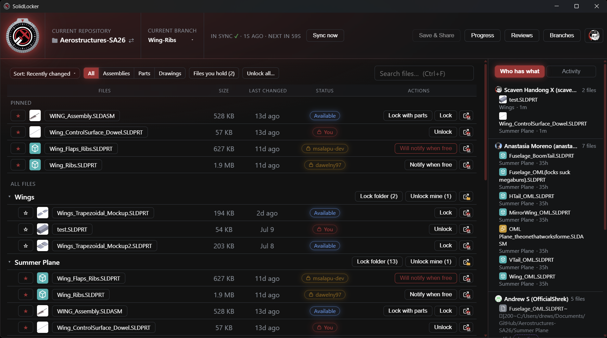
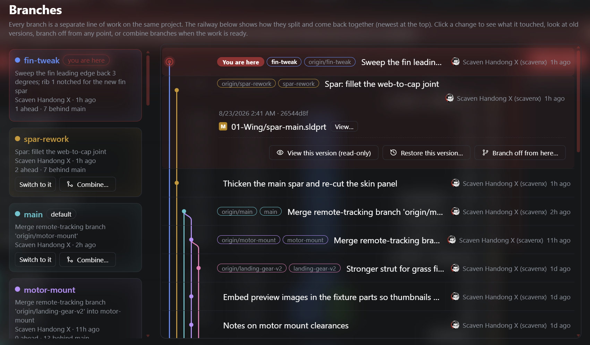
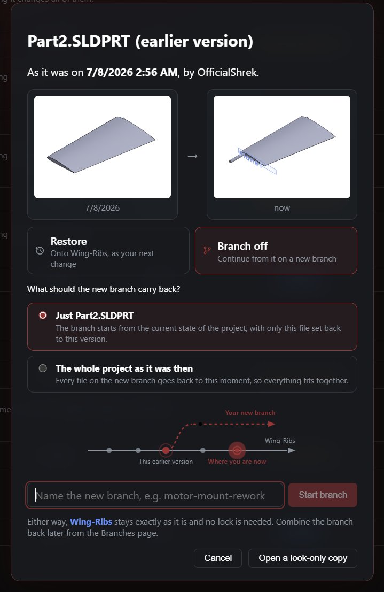
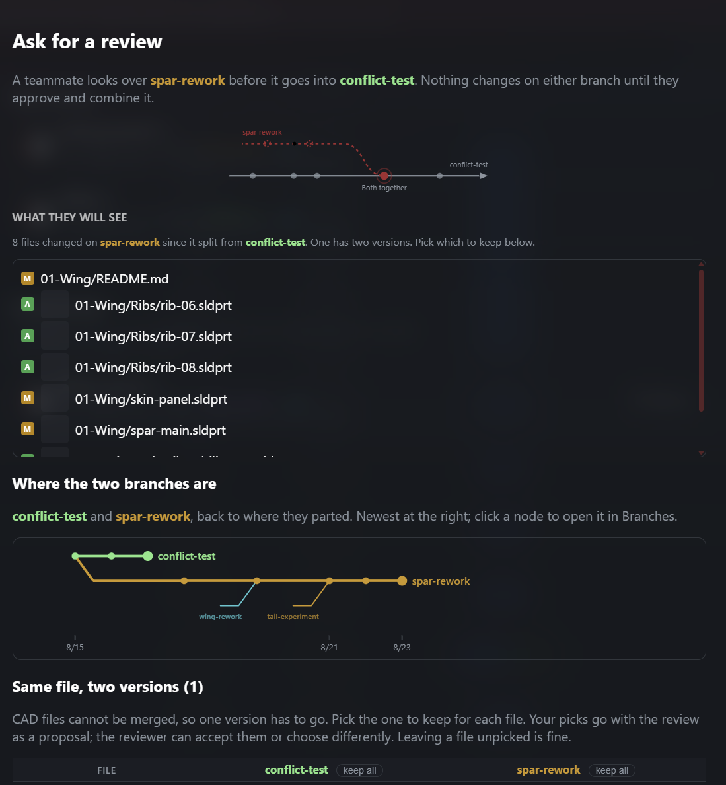
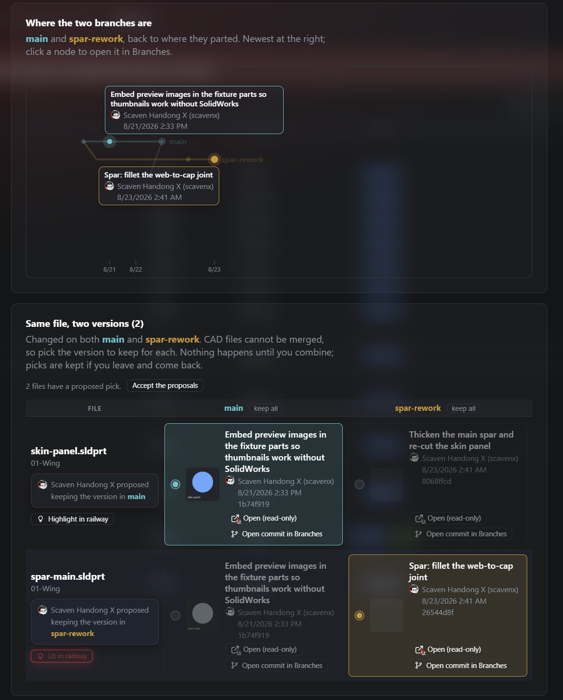
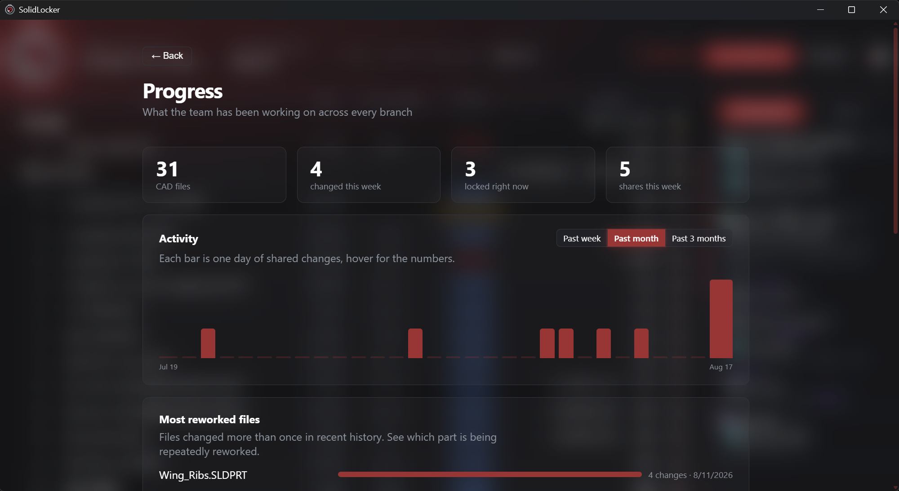
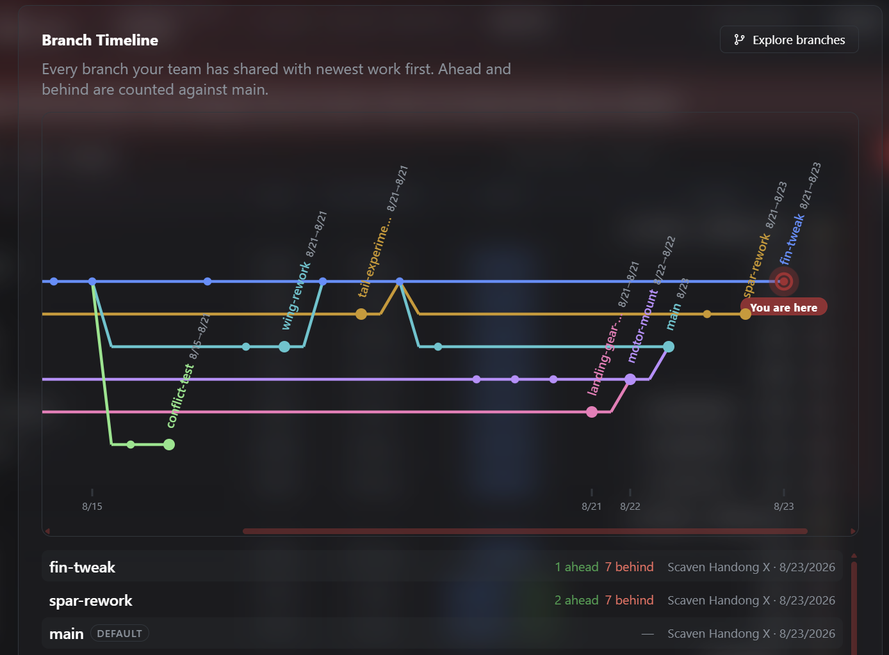

<p align="center">
  
</p>

# SolidLocker
**Version control for SolidWorks teams**

Keep every part, assembly, and drawing in your team's GitHub repo with its full history, without making everyone on the team learn Git.

SolidLocker gives common Git workflows simple names and buttons. You can **Save & Share** your work, branch off to try a new design, restore an older version, or ask a teammate to review your changes before they are added back to the main branch.

It also solves one of the biggest problems with using Git for CAD: **SolidWorks files cannot be merged.** SolidLocker uses Git LFS file locking so only one person can edit a file at a time. Lock an assembly or drawing and its referenced files are locked with it, preventing two people from accidentally working on the same files and overwriting each other's work.

SolidLocker works with the GitHub repo and accounts your team already uses. There is no separate server to run, no new account to create, and no PDM system to maintain.

Developed by [Scaven X](https://github.com/scavenx) at RU Airborne.

  
*The dashboard shows the lock status of every file and who currently has it locked.*

## The problem it solves

Git is great for software because code can usually be compared and merged when
two people change the same file. SolidWorks files do not work that way. If two
people edit the same part separately, Git cannot combine their changes
afterward. One version has to replace the other.

SolidLocker fills that gap with file locking. Files stay read-only until you
lock them, and the lock is recorded on GitHub right away. If someone else
already has the file locked, you cannot accidentally start editing it too.

GitHub and GitHub Desktop do not help much here either. Their pull request and
merge screens are built around showing a text diff, and a SolidWorks file has
nothing to diff, so neither the website nor GitHub Desktop can resolve a
conflict in a SolidWorks file. They just tell you to sort it out with Git in a
terminal. SolidLocker gives that an intuitive interface instead: a railway map
of the branches, a side-by-side sort box that shows both versions of a
clashing file with a picture, author and date so you pick the one to keep, and
reviews inside the app where a teammate can accept your picks or choose
differently before the work joins the main branch. Branching off and restoring
an earlier version are buttons too.

## Feature Highlights

- **Everyday words, not Git words**: Nobody on the team needs to know Git. You "Save & Share"
  instead of commit and push, "Combine" instead of merge, "Ask for a review" instead of opening a
  pull request. Every term is listed against its Git meaning in
  [What the words mean](#what-the-words-mean).

- **Safe by default**: Files stay read only until you lock them, so nothing unlocked gets changed by
  accident. Every lock is an atomic lock on GitHub's server, so two people can never hold
  the same file at once. Unlock won't let go until your newest version is pushed.

- **Lock with parts**: Lock a drawing or an assembly and SolidLocker locks every part it depends on
  in the same click, so you grab the whole set at once. It figures out those parts by asking your
  running copy of SolidWorks directly, so the list matches what the file actually uses. You can
  also lock a whole folder at once from the file tree.

  <p align="center">
  
  <br>
  <em>Lock with parts: the references come straight from your running SolidWorks, and the whole set locks in one click.</em>
  </p>

- **Branches page**: A railway map of every branch in the project, coloured so each branch is easy to
  tell apart, with "You are here" on your current commit. Open any commit to see what changed, view
  a file as it was back then, restore that version, or branch off from that point. Restoring,
  branching off and combining all happen right there in the app.

  <p align="center">
  
  <br>
  <em>The Branches page: every branch on one railway, with branch off, restore and combine a click away</em>
  </p>

- **Get an old version back, safely**: Pick any commit on the railway and you have two ways to
  return to it. Restore puts that version of the files back in your working folder as a new save,
  so nothing later is thrown away and the history stays intact. Branch off starts a new branch from
  that point instead, so you can explore an earlier state without touching the branch you came
  from. Either way, the version you are on now is never lost.

  <table align="center">
    <tr>
      <td align="center"><br><em>Restore: bring an earlier version back.</em></td>
      <td align="center"><br><em>Branch off: start a new branch from an eariler point.</em></td>
    </tr>
  </table>

- **Combine branches**: Bring one branch into another from the Branches page. SolidLocker shows what
  would change first, with thumbnails, and tells you if the two branches touched the same CAD file.
  If they did, a sort box lists each clash with both versions side by side so you pick which one to
  keep. A compact railway above it shows just the two branches back to where they parted.

  <p align="center">
  
  <br>
  <em>Combine: see what the other branch brings before anything changes.</em>
  </p>

- **Reviews, inside the app**: On GitHub or GitHub Desktop a SolidWorks clash is a binary diff with
  nothing to read and no way to choose a side, so reviewing CAD there is a dead end. SolidLocker
  does the whole review itself: ask the team for one straight from the Combine dialog, with a
  title, a note and, if files clash, your suggested picks. Reviewers see the changed files with
  thumbnails, the conversation so far, and the same sort box. They can accept your picks with one
  click or pick differently, ask for changes, or approve and combine in one go. Closed reviews stay
  listed with what was kept, and offer to tidy the branch away once it is in.

  <p align="center">
  
  <br>
  <em>Reviews: open and closed reviews are shown directly in the app.</em>
  </p>

  <p align="center">
  
  <br>
  <em>The sort box: both versions of a clashing file, with a picture, author and date, so you choose the one to keep.</em>
  </p>

- **See who has what**: A "Who has what" panel lists every locked file and who holds it, with a jump
  to file button. Locks that live on another branch, or that point at a file no longer present,
  are flagged so nothing looks missing. An activity feed shows recent history. Waiting on a file
  someone else holds? Tap "Notify when free" and SolidLocker pings you the moment it is unlocked.

- **Keep track of progress**: A Progress page shows what the team has been up to across every
  branch: what changed this week, a chart of shared changes per day, which parts are being reworked
  the most, and who made the most changes recently. A branch timeline puts every branch and change
  on one railway, and you can branch off, restore or combine straight from it.

  <p align="center">
  
  <br>
  <em>The Progress page: what the team has worked on across every branch.</em>
  </p>

  <p align="center">
  
  <br>
  <em>The branch timeline: every branch and change on one railway.</em>
  </p>

- **Branch switching**: Switch branches right from the toolbar. Untracked files never block a switch
  or a pull. If a switch would trample local files you haven't committed, SolidLocker offers to set
  them aside instead of discarding them.

- **Works offline**: Lost your connection? You can still edit any file you locked before you went
  offline. SolidLocker shows the last known locks and pauses locking and sharing until you are
  back, then picks up on its own.

- **Runs in the background**: Closing the window keeps SolidLocker in the system tray, so it still
  protects your files and can tell you when a file you are waiting on comes free.

## Getting started

### Requirements

- Windows 10 or 11.
- Git and Git LFS, signed in to GitHub (GitHub Desktop provides all of this).
- A GitHub repository that uses Git LFS with SolidWorks files marked
  `lockable`.
- SolidWorks, for the "lock with parts" detection.

### Install

1. Download the latest `SolidLocker_x64-setup.exe` from the [Releases](https://github.com/RU-Airborne/SolidLocker/releases) page
   and run it.
2. Open SolidLocker and point it at your team's project folder (a local clone of
   the GitHub repository).

### Windows SmartScreen

  <p align="center">
  
  <br>
  <em>Windows SmartScreen would block installation due to unrecognized publisher</em>
  </p>

When you run the installer, Windows may show a blue "Windows protected your PC" box. That is
SmartScreen, and it appears because the installer is not signed with a paid code signing
certificate, not because anything is wrong with it. Click **More info**, then **Run anyway**.

If you would rather not take our word for it, everything is here in the open: clone the
repository and read the source yourself (or have an AI read it for you), then build the
installer or run it in dev mode on your own machine. See [Building from source](#building-from-source).

### First run

SolidLocker needs Git and Git LFS on your computer, plus a GitHub sign in. The
easiest way to get all three at once is
[GitHub Desktop](https://desktop.github.com/): install it, sign in, and
SolidLocker will find everything it needs. If Git is missing, the app tells you
and links you to the download.

The first time SolidLocker talks to GitHub, your system credential helper opens
a browser sign in. That is your own GitHub login. SolidLocker never asks for a
password itself and stores no credentials of its own.

## Working with SolidLocker

1. **Lock** the file you want to work on. It turns writable on your machine, and
   everyone else can see it's yours. Nobody else can grab it until you let go.
   Lock an assembly or a drawing and all of its parts come along with it.
2. **Edit** it in SolidWorks like you normally would.
3. **Save & Share** when you hit a good stopping point. One click saves your work
   up to the team repo (a commit and a push) so everyone else can pull it.
4. **Unlock** when you're done. SolidLocker makes sure your latest version is
   safely on GitHub first, then frees the file for the next person.


## What the words mean

SolidLocker uses everyday words in the app. If you know Git, this is what they map to.

| In SolidLocker | In Git / Git LFS |
| --- | --- |
| Lock / Release | `git lfs lock` / `git lfs unlock` on the file. Files stay read-only until locked. |
| Lock with parts | One `git lfs lock` per referenced part, found by asking SolidWorks for the file's references. |
| Force unlock | `git lfs unlock --force` |
| Save & Share | `git add`, `git commit`, `git push` (LFS objects upload with the push). |
| Sync now / "pulling in team changes" | `git fetch` then a fast-forward `git pull`, every 60 seconds or on demand. |
| Who has what | `git lfs locks`, matched against branches and files. |
| Discard | `git restore` on the file (unlocked files are never touched). |
| Set aside | Untracked files are moved to a `<project>-SetAside` folder next to the project before a switch. Not a `git stash`. |
| Switch branch | `git switch`, after checking nothing locked would be trampled. |
| Branch off from here | `git switch -c <name> <commit>` |
| View this version (read-only) | A temporary detached checkout of that commit; one click returns you. |
| Restore this version | `git restore --source <commit> -- <file>`, then Save & Share when you are happy. |
| Branches page | `git log --all --graph`, drawn as a railway. |
| Progress page | `git log` with per-file and per-author statistics across all branches. |
| Combine / Merge into here | `git merge` of the other branch into the one you are on. |
| "Same file, two versions" / the sort box | A merge conflict on a binary file, resolved by keeping `--ours` or `--theirs` for each file. |
| Undo (after a combine) | `git reset --hard ORIG_HEAD`, only while nothing has been shared yet. |
| Ask for a review / Review | A pull request on GitHub. |
| Picks / proposals | Per-file review comments on the pull request, marked so the app can read them back. |
| Ask for changes | A "changes requested" review on the pull request. |
| Approve and combine | An approving review followed by merging the pull request. |
| Tidy up / Delete branch | `git push origin --delete <branch>` and `git branch -D <branch>`, only once the branch is fully merged. |
| Fix permissions | Re-applies `lfs.setlockablereadonly`: locked files writable, everything else read-only. |

## Good to know

- **Locks aren't tied to a branch**: A file you lock is locked everywhere.
  SolidLocker sorts out which branch it lives on for you.
- **Auto sync only pulls when your folder is clean**: If you've got edits going,
  it leaves them alone and waits.
- **Unlock is a safety net**: If your latest work isn't on GitHub yet, it'll ask
  you to Save & Share first.
- **SolidWorks scratch files are ignored**: The temp files SolidWorks makes while
  a doc is open (their names start with `~$`) get filtered out, so the app won't
  nag you to Save & Share when you haven't really changed anything.
- **GitHub decides who may approve**: The app never lets you approve your own review, because
  GitHub won't. If the repo has a branch rule requiring reviews, "Merge into here" is switched off
  and the reviewed route is the only way in.


## Troubleshooting

- **Q: It keeps asking me to Save & Share, but I didn’t change anything.**  

  **A:** This is usually caused by leftover SolidWorks temporary files (`~$...`) that were accidentally committed to the repository. SolidLocker ignores these files, but they still need to be removed from the repo. Ask whoever manages the repository to clean them up.

- **Q: It looks offline even though I have internet.**  

  **A:** The local lock cache may have been corrupted by an interrupted operation. SolidLocker detects this and repairs the cache automatically, so wait a moment and try again.


- **Q: I pressed "Ask for changes" on my own review and it came through as a comment.**  

  **A:** GitHub does not accept a verdict from the person who opened the request, so the app
  posts your words and picks as a comment instead and tells you. A teammate's "Ask for changes"
  is a real block.

- **Q: A file shows a lock that nobody remembers making.**  

  **A:** Use the **Force Unlock** option, but only if you are sure nobody is currently working on the file.


## Building from source

Prerequisites: [Node LTS](https://nodejs.org),
[Rust](https://rustup.rs), and Visual Studio Build Tools with C++.
Git and Git LFS must be installed and signed in to GitHub.

```sh
npm install
npm run tauri dev      # run in dev interactive mode
npm run tauri build    # build installers
```

The Windows installer is created at
`src-tauri\target\release\bundle\nsis`.

## Project Layout

- `src-tauri/src/` is the Rust backend. `proc.rs` runs every git command,
  `lfs.rs` handles locks, `workflow.rs` holds the lock, unlock, and share
  rules, `repo.rs` covers status, branches, and history, `swrefs.rs` talks
  to a running SolidWorks to find file references, and `gate.rs` makes sure
  only one of them touches the project folder at a time.
- `src/` is the React frontend. `components/dashboard/` is the main window and
  `components/dialogs/` the modals. The pieces the dashboard used to hold
  inline live beside it: `sync.ts` keeps up with the team, `signin.ts` handles
  the GitHub credentials, `exit.ts` decides what closing the window means,
  `shortcuts.ts` the keyboard, `persist.ts` the settings that survive a
  restart, and `copy.ts` the user facing text.
- `src/styles/` is the stylesheet, split by area. `styles.css` is just the
  import list, and the order in it matters: `glass.css` near the end
  deliberately overrides selectors set earlier, so nothing there can be
  reordered without changing what wins.
